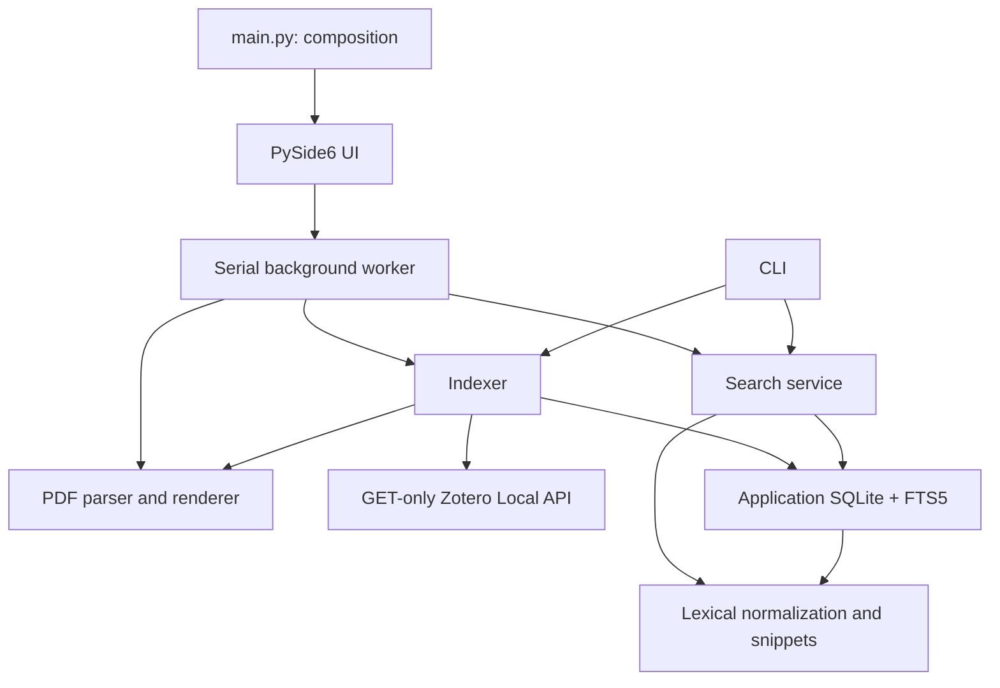

# Research Assistant V0.1 architecture

All six stages are implemented. The external API boundary remains reserved only.

## Dependency direction

No backend module imports Qt. Zotero integration owns HTTP and metadata; the PDF
parser accepts explicit paths and never performs HTTP; database/search know only
the application index. `app/external_api` has no active code or dependencies.
Future REST/MCP/AI adapters can call these backend services without the GUI.

## Zotero boundary

Only GET requests to port 23119 on loopback are permitted. Redirects and environment
proxies are disabled. Requests use `/api/`, personal-library collections/items,
item children and attachment `/file/view/url`. The API owns attachment-path discovery.
`zotero.sqlite` is never opened. Lists use explicit pagination.
Full-library indexing groups children from an item snapshot to avoid one children
request per paper; attachment locations are resolved as papers are consumed.

The probe determines API availability, not definitive OS process state. 403 explains
the Local API preference. Timeouts and refused connections have clear errors without
cloud fallback. [Zotero Local API documentation](https://www.zotero.org/support/dev/web_api/v3/local_api).

The index binds to a server ID when supplied, otherwise a documented legacy local
identity. A different available ID requires a separate index. On older Zotero versions,
changing libraries requires a new application database; V0.1 does not infer identity
from Zotero's internal files.

## Persistence

`data/literature.db` is application-owned and ignored by source control. Schema v2
adds paper tags/item type and attachment content hashes through an additive migration;
existing page IDs and FTS rows are preserved.

| Table | Purpose |
| --- | --- |
| meta | Source identity; SQLite user_version tracks schema |
| papers | Item key, title, authors JSON, year, journal, DOI, index timestamp |
| collections | Key, name, parent key |
| paper_collections | Many-to-many collection membership |
| attachments | Paper FK, attachment key, path, fingerprint, status, error, timestamp |
| pages | Attachment FK, 1-based physical page, original text, normalized text |
| pages_fts | External-content FTS5 table keyed to pages.id |

Foreign keys and cascades are enabled. Triggers maintain FTS5 on page changes.
An attachment's page set is replaced transactionally, so failures roll back.
WAL supports readers alongside a writer; each worker/request owns its connection.
Schema mismatch, unrecognized nonempty databases and absent FTS5 surface as errors.

## Indexing and cancellation

Metadata is compared each run; unchanged values and memberships are not rewritten.
Metadata-only changes preserve PDF pages. Streaming SHA-256 detects content changes
even with unchanged size/mtime. Parser and normalizer versions also invalidate parsed
text. Unchanged content with changed file timestamps does not reparse. Failed files
retry. Legacy entries get a content-hash baseline without reparsing when their previous
stat/version fingerprint agrees. File state is checked before/after reading/extraction.

Counters are exclusive per completed paper: indexed (new), updated (existing changes),
skipped (unchanged), failed (any attachment failure). PDF parsing counts are separate.
Progress emits running totals, which remain visible after automatic search refresh.
Full Rebuild is an explicit separate UI/CLI action that re-extracts the entire personal
library. Normal incremental update never invokes it or clears the database.

Every page is extracted separately, including blank pages. A PDF without text gets
`TEXT_EXTRACTION_FAILED`. No OCR or invented content. PDF failures are isolated and
counted. A failed refresh removes that attachment's stale searchable text; a metadata
fetch failure preserves cached text and reports the error.

Membership is reconciled after complete reads. Obsolete attachments are removed only
after complete attachment listings. Obsolete papers are removed only at the end of a
successful whole-library scan. Only application cache rows are removed. Cancellation
preserves committed work; checks occur between files/pages, then shutdown waits for
the worker to finish safely.

## Search contract

All keywords must match **the same physical PDF page**. No silent OR fallback or
paper-wide inference. Input words become quoted, bound MATCH terms with size limits.
FTS5 uses `porter unicode61` and BM25; item key, attachment key and page break ties.
Collection, year and journal filters use bound SQL parameters. Results paginate.

NFKC normalizes compatible typography, chemical formula digit spacing is joined,
line-end hyphenation is removed and band gap/bandgap variants are reconciled.
This is lexical matching. Original text stays separate. Snippets are original-text
slices selected using normalization offsets, not generated summaries. FTS operates
on normalized text, so its built-in snippet function is not used for source excerpts.
[SQLite FTS5 documentation](https://www.sqlite.org/fts5.html).

Each result includes title, authors, year, journal, DOI, item/attachment key, physical
page, snippet, full text and PDF path. Reference pages may match; this does not imply
support for a scientific claim.

## Desktop

Widgets stay on the main thread. A persistent worker runs connection, indexing,
search and rendering serially. Conflicting backend actions are disabled during tasks;
the UI remains responsive. Cancellation uses a thread-safe Event. PyMuPDF documents
never cross threads and PDF operations never run concurrently. Errors become signals.

The UI has collection selection, progress, keyword/filter fields, result cards,
highlighted source text, copy actions and a PDF-page dialog. Rendering verifies the
page text still matches the index. The built-in dialog guarantees the requested page;
the external file opener uses the OS default reader and cannot guarantee its page.

[PyMuPDF Page](https://pymupdf.readthedocs.io/en/latest/page.html),
[Qt worker threads](https://doc.qt.io/qtforpython-6/PySide6/QtCore/QThread.html).

## Verification

Stages were tested incrementally: API listing; page extraction; SQLite integrity;
incremental indexing/error isolation; search/filter tests; Qt workers, clipboard and
source rendering. Real-data acceptance reopens each matching PDF page.
See [verification.md](verification.md).
